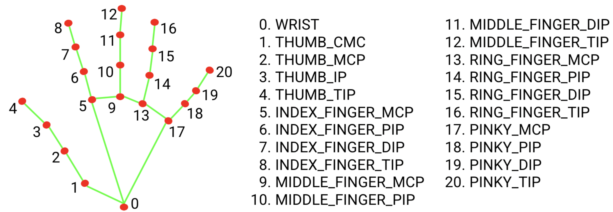

#  HandTrackingWordle

**Play Wordle without touching your keyboard.** A webcam and a real-time hand-tracking pipeline turn your index finger into a cursor over an on-screen keyboard. Point to type, make a fist to clear.


<!-- TIP: record a short GIF of yourself playing and drop it here — it's the single best thing you can add to this repo. -->
<!--  -->

## How it works

1. **Capture:** OpenCV reads frames from the webcam.
2. **Track:** MediaPipe Hands finds the **21 hand landmarks** on each frame (see the landmark diagram below).
3. **Classify the gesture:** finger states are worked out by comparing each fingertip to its middle joint:
   -  **Index finger only**: hover over a key to press it.
   -  **Fist**: clear the current guess.
4. **Debounce:** a frame-based cooldown keeps one hover from registering as several presses.
5. **Game logic:** guesses are checked against a word list, and keys are coloured green (right letter, right spot) or yellow (right letter, wrong spot), with six tries.



## What's in the repo

| Folder | Description |
|---|---|
| `Hand_Tracking_Wordle_Game/` | The full Wordle game: on-screen keyboard, guess grid, win/lose states |
| `Hand_Tracking_Keyboard_Build/` | The first version: a standalone virtual keyboard you type on in the air |
| `2D_shape_manipulation/` | A gesture-controlled shape demo used to prototype the interaction |

## Running it

```bash
git clone https://github.com/akutsner/HandTrackingWordle.git
cd HandTrackingWordle
pip install opencv-python mediapipe
python -m Hand_Tracking_Wordle_Game.HandTrackingWordle
```

You'll need a webcam. Good lighting and a plain background help the tracking a lot.

## What I learned

- Building a **real-time loop** where capture, inference, game logic and rendering all happen every frame
- Turning noisy, continuous landmark data into **discrete, reliable inputs** (gesture rules and debouncing)
- Prototyping in steps: shape demo, then keyboard, then full game
